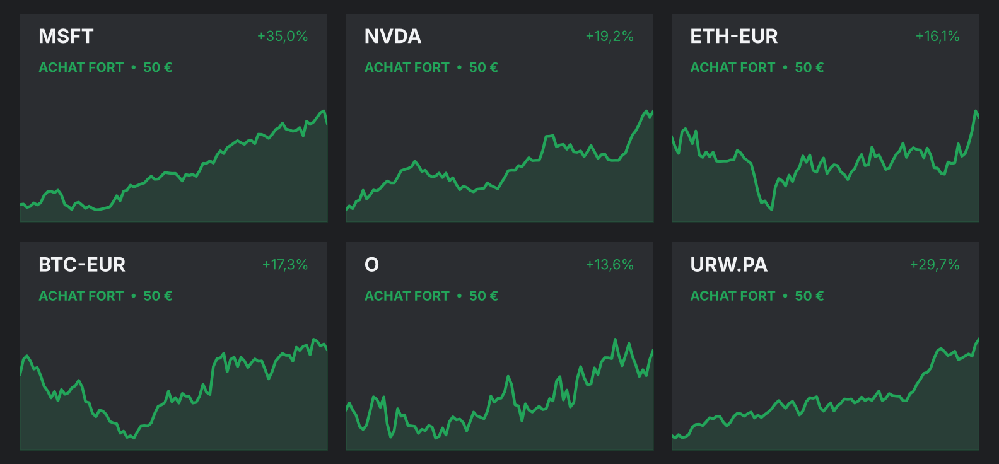

# Fibot — bot Discord de signaux actions, crypto, immobilier coté




*Aperçus générés avec des données simulées.*

## Installation

1. https://discord.com/developers/applications → **New Application** → onglet **Bot** → **Reset Token**, copie le token.
2. **OAuth2 → URL Generator** : coche `bot` et `applications.commands`, permissions `Send Messages`, `Embed Links`, `Attach Files`. Ouvre l'URL générée pour inviter le bot.
3. Copie `.env.example` en `.env` et remplis-le (ne publie jamais ce fichier, il est ignoré par git) :

```
DISCORD_TOKEN=ton_token
CHANNEL_ID=id_du_salon_des_alertes
GUILD_ID=id_de_ton_serveur
OWNER_ID=ton_id_discord
BUDGET_MAX=50
TAUX_PFU=31.4
```

(ID : Discord → Paramètres → Avancés → Mode développeur, puis clic droit → Copier l'identifiant.)

4. Lance :

```
pip install -r requirements.txt
python bot.py
```

Si tu avais déjà la première version : tes anciens achats (`positions.json`) ne sont pas repris, ressaisis-les avec `/achat`.

## Commandes

| Commande | Effet |
|---|---|
| `/top [theme]` | Alerte complète : opportunités par catégorie, mises, stops, planche de graphiques, menu de détail |
| `/analyse NVDA` | Fiche d'un actif avec graphique (cours, moyennes, stop, objectif, RSI) |
| `/marche` | Météo des marchés : CAC 40, S&P 500, Nasdaq, bitcoin, or, VIX, sentiment crypto |
| `/achat` `/vente` `/positions` | Suivi de tes positions, gain/perte, signal par position, impôt estimé |
| `/alerte BTC-EUR 90000` | Alerte de prix, le bot te mentionne quand le seuil est franchi |
| `/suivre TICKER` | Ajoute un actif à la liste surveillée |
| `/dca CW8.PA 50` | Simule un investissement mensuel régulier sur 2 ans |
| `/performance` | Bilan réel des signaux d'achat passés du bot |
| `/fiscalite 200` | Estimation de l'impôt sur une plus-value |
| `/legal` `/mesdonnees` `/supprimer` | Mentions légales, export et effacement de tes données |

## Automatismes

- **9h15** (ouverture Paris) et **15h45** (ouverture US) : signaux tous thèmes.
- **20h30** et week-end : point crypto (marché ouvert 24h/24).
- **Toutes les 20 min** : alertes de prix et positions à revoir (perte > 15 %, signal de vente).

## Méthode des signaux

Score de −100 à +100 : tendance (moyennes 50/200 jours), RSI 14, MACD, performance 3 mois.

- **Crypto** : ajout de l'indice Fear & Greed (peur extrême = bonus, euphorie = malus), mise réduite de 40 % si volatilité > 60 %.
- **Immobilier coté** (foncières SIIC/REIT : Unibail, Klépierre, Gecina, Covivio, Realty Income…) : ajout de la tendance du taux 10 ans (taux en baisse = bonus) et du rendement du dividende.
- score ≥ 40 → 50 € · score ≥ 20 → 30 € · sinon attendre · ≤ −20 alléger · ≤ −40 vendre.

Le bot ne couvre pas l'immobilier physique ni les SCPI (pas de cotation quotidienne).

## Cadre légal (France) — à lire

Ce que le bot fait déjà :

- **Acceptation obligatoire** des mentions légales avant la première commande, horodatée.
- **Avertissement sur chaque message** : signal générique, pas un conseil personnalisé, risque de perte.
- **Mode privé** : avec `OWNER_ID`, toi seul peux utiliser le bot.
- **Transparence** : méthode publique, sources de données citées, conflits d'intérêts déclarés, bilan des signaux affiché sans tri (`/performance`).
- **RGPD** : données minimales stockées localement (`data.json`), export (`/mesdonnees`), effacement (`/supprimer`).

Ce que tu dois savoir :

- **Usage personnel** (toi seul, `OWNER_ID` renseigné) : c'est un outil d'aide à la décision pour toi-même, pas un service rendu à des tiers.
- **Si tu l'ouvres à d'autres personnes**, tu diffuses des recommandations d'investissement : la réglementation européenne (règlement Abus de marché) impose alors présentation objective et déclaration de tes intérêts. Les mentions du bot vont dans ce sens mais ne te dispensent pas de vérifier ta situation.
- **Recommandations personnalisées à des tiers, ou service payant** : c'est du conseil en investissement, activité réglementée qui exige un statut (conseiller en investissements financiers immatriculé à l'ORIAS, ou prestataire agréé). Ne le fais pas sans ce statut.
- **Promotion de plateformes ou de crypto** contre rémunération : strictement encadrée, à éviter.
- **Données Yahoo Finance** : usage personnel uniquement, pas de redistribution commerciale.
- **Fiscalité** : `TAUX_PFU` est réglé sur 31,4 % (taux 2026). Vérifie chaque année sur impots.gouv.fr.

Ce document n'est pas un avis juridique. Pour un usage public ou commercial, consulte un avocat ou l'AMF.
