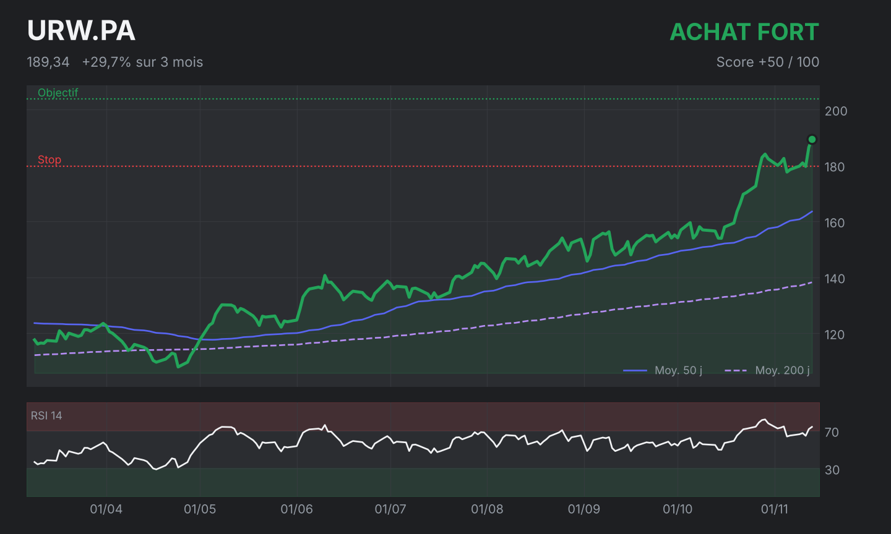

# Fibot — bot Discord de signaux actions, crypto, immobilier coté




*Aperçus générés avec des données simulées.*

## Mise en route (10 minutes)

### 1. Créer le bot sur Discord

1. Va sur https://discord.com/developers/applications → **New Application** → donne-lui un nom.
2. Onglet **Bot** → **Reset Token** → copie le token (il ne s'affiche qu'une fois). Aucun « Privileged Gateway Intent » n'est nécessaire, laisse-les décochés.
3. Onglet **Installation** : pour un bot privé, mets *Install Link* sur **None**, puis dans l'onglet **Bot** décoche **Public Bot** (personne d'autre ne pourra l'inviter).

### 2. L'inviter sur ton serveur

Onglet **OAuth2 → URL Generator** : coche `bot` et `applications.commands`, puis les permissions `View Channels`, `Send Messages`, `Embed Links`, `Attach Files`. Ouvre l'URL générée et choisis ton serveur.

Plus simple : au démarrage, le bot affiche lui-même son **lien d'invitation** tout prêt dans la console.

### 3. Configurer

Copie `.env.example` en `.env` et remplis-le (ce fichier est ignoré par git, ne le publie jamais) :

| Variable | Obligatoire | Rôle |
|---|---|---|
| `DISCORD_TOKEN` | oui | Le token de l'étape 1 |
| `CHANNEL_ID` | conseillé | Salon des alertes automatiques. Vide = commandes seules |
| `GUILD_ID` | conseillé | Ton serveur : les commandes `/` apparaissent tout de suite (sinon jusqu'à 1 h) |
| `OWNER_ID` | conseillé | Ton identifiant : bot privé, toi seul peux l'utiliser |
| `BUDGET_MAX` | non | Montant max par achat (50 € par défaut) |
| `TAUX_PFU` | non | Flat tax en % (31,4 par défaut) |

Pour copier un identifiant : Discord → Paramètres → Avancés → **Mode développeur**, puis clic droit sur le serveur, le salon ou ton profil → **Copier l'identifiant**.

### 4. Lancer

**Sur ton ordinateur** (Python 3.10 ou plus récent) :

```
python -m venv .venv
source .venv/bin/activate        # Windows : .venv\Scripts\activate
pip install -r requirements.txt
python bot.py
```

**Avec Docker** (PC, NAS, Raspberry Pi, VPS) — redémarre tout seul et garde tes données dans un volume :

```
docker compose up -d --build
docker compose logs -f           # voir les messages du bot
```

Le bot ne fonctionne que tant que ce programme tourne. Pour recevoir les alertes de 9h15, 15h45 et 20h30 sans laisser ton PC allumé, héberge-le sur une machine allumée en permanence (Raspberry Pi, NAS, petit VPS à quelques euros par mois). Le bot n'ouvre aucun port : pas de configuration réseau à prévoir.

Tes positions, alertes et acceptations sont dans `data.json` (ou dans le volume Docker `fibot-data`). Sauvegarde ce fichier si tu changes de machine. Sur un hébergeur à disque éphémère, monte un volume persistant et pointe `DATA_DIR` dessus.

### Ça ne marche pas ?

| Symptôme | Cause probable |
|---|---|
| `Token refusé par Discord` | Token mal copié ou régénéré depuis : refais **Reset Token** et mets à jour `.env` |
| Les commandes `/` n'apparaissent pas | `GUILD_ID` vide (attends jusqu'à 1 h) ou faux, ou bot invité sans le scope `applications.commands` |
| Pas d'alertes automatiques | `CHANNEL_ID` vide ou faux, ou le bot n'a pas le droit d'écrire dans ce salon (la console le dit au démarrage) |
| « Ce bot est privé » | `OWNER_ID` ne correspond pas à ton identifiant |
| `Ticker … introuvable` partout | Yahoo Finance injoignable ou limité depuis ta machine : réessaie quelques minutes plus tard |

### Tests

```
pip install pytest
pytest
```

Les tests tournent hors ligne (données simulées), sans token.

## Commandes

| Commande | Effet |
|---|---|
| `/top [theme]` | Alerte complète : opportunités par catégorie, mises, stops, planche de graphiques, menu de détail |
| `/analyse NVDA` | Fiche d'un actif avec graphique (cours, moyennes, stop, objectif, RSI) |
| `/marche` | Météo des marchés : CAC 40, S&P 500, Nasdaq, bitcoin, or, VIX, sentiment crypto |
| `/achat` `/vente` `/positions` | Suivi de tes positions, gain/perte, signal par position, impôt estimé |
| `/alerte BTC-EUR 90000` | Alerte de prix, le bot te mentionne quand le seuil est franchi |
| `/stopalerte BTC-EUR` | Supprime tes alertes de prix sur un actif |
| `/suivre TICKER` | Ajoute un actif à la liste surveillée |
| `/dca CW8.PA 50` | Simule un investissement mensuel régulier sur 2 ans |
| `/performance` | Bilan réel des signaux d'achat passés du bot |
| `/fiscalite 200` | Estimation de l'impôt sur une plus-value |
| `/themes` `/aide` | Liste des actifs suivis, liste des commandes |
| `/legal` `/mesdonnees` `/supprimer` | Mentions légales, export et effacement de tes données |

## Automatismes

- **9h15** (ouverture Paris) et **15h45** (ouverture US) : signaux tous thèmes.
- **20h30** et week-end : point crypto (marché ouvert 24h/24).
- **Toutes les 20 min** : alertes de prix et positions à revoir (perte > 15 %, signal de vente).

## Méthode des signaux

Score de −100 à +100 : tendance (moyennes 50/200 jours), RSI 14, MACD, performance 3 mois.

- **Crypto** : ajout de l'indice Fear & Greed (peur extrême = bonus, euphorie = malus), mise réduite de 40 % si volatilité > 60 %.
- **Immobilier coté** (foncières SIIC/REIT : Unibail, Klépierre, Gecina, Covivio, Realty Income…) : ajout de la tendance du taux 10 ans (taux en baisse = bonus) et du rendement du dividende.
- score ≥ 40 → 50 € · score ≥ 20 → 30 € · sinon attendre · ≤ −20 alléger · ≤ −40 vendre.

Le bot ne couvre pas l'immobilier physique ni les SCPI (pas de cotation quotidienne).

## Cadre légal (France) — à lire

Ce que le bot fait déjà :

- **Acceptation obligatoire** des mentions légales avant la première commande, horodatée.
- **Avertissement sur chaque message** : signal générique, pas un conseil personnalisé, risque de perte.
- **Mode privé** : avec `OWNER_ID`, toi seul peux utiliser le bot.
- **Transparence** : méthode publique, sources de données citées, conflits d'intérêts déclarés, bilan des signaux affiché sans tri (`/performance`).
- **RGPD** : données minimales stockées localement (`data.json`), export (`/mesdonnees`), effacement (`/supprimer`).

Ce que tu dois savoir :

- **Usage personnel** (toi seul, `OWNER_ID` renseigné) : c'est un outil d'aide à la décision pour toi-même, pas un service rendu à des tiers.
- **Si tu l'ouvres à d'autres personnes**, tu diffuses des recommandations d'investissement : la réglementation européenne (règlement Abus de marché) impose alors présentation objective et déclaration de tes intérêts. Les mentions du bot vont dans ce sens mais ne te dispensent pas de vérifier ta situation.
- **Recommandations personnalisées à des tiers, ou service payant** : c'est du conseil en investissement, activité réglementée qui exige un statut (conseiller en investissements financiers immatriculé à l'ORIAS, ou prestataire agréé). Ne le fais pas sans ce statut.
- **Promotion de plateformes ou de crypto** contre rémunération : strictement encadrée, à éviter.
- **Données Yahoo Finance** : usage personnel uniquement, pas de redistribution commerciale.
- **Fiscalité** : `TAUX_PFU` est réglé sur 31,4 % (taux 2026). Vérifie chaque année sur impots.gouv.fr.

Ce document n'est pas un avis juridique. Pour un usage public ou commercial, consulte un avocat ou l'AMF.
